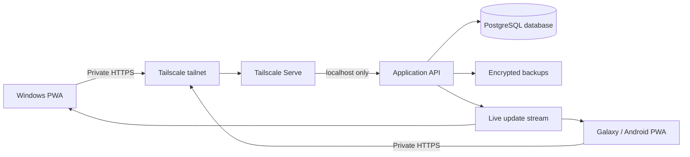

# familyChoreGame — Strategic Project Plan

## 1. Purpose

`familyChoreGame` is a private, bilingual family chore game. Family members manage chores for the current and coming weeks, mark current-week chores complete, and share one scoreboard across Windows PCs and Samsung/Android phones.

This plan takes the existing browser prototype to a durable, shared, secure application without exposing the application to the public internet.

### Current implementation status

The local shared-backend foundation is implemented: Java 21/Spring Boot serves the PWA and `/api/v1`, Jdbi persists data in PostgreSQL, first-run family onboarding is available, chore catalogs load from a packaged resource, and current/coming-week rules are enforced server-side. A first right slice is also implemented: a resource-backed bilingual catalog, all-week or Friday/Saturday availability, per-member daily caps, spendable balances, atomic retry-safe redemptions, and wallet summaries.

The remaining plan is still required for production readiness. Member/PIN authentication, parent/child authorization, login throttling/lockout, CSRF protection, and authentication event logs are implemented; PIN recovery/change, Tailscale deployment, SSE, backups, the full point ledger and expiration lifecycle, redemption approval/refund states, and parent-managed vacation overrides are not implemented. A packaged 2026–2027 Jewish state-school calendar currently supplies vacation-day behavior. `CURRENT_IMPLEMENTED_LOGIC.md` is authoritative for current behavior.

## 2. Product goals

The finished application must:

1. Work on Windows and Samsung/Android devices from one shared codebase.
2. Default to Hebrew, support English, and correctly switch RTL/LTR layouts.
3. Store family data persistently and survive application/server restarts.
4. Show the same current data on every authorized device.
5. Remain accessible only inside the family's private Tailscale network.
6. Be installable and feel like a normal application on Windows and Android.
7. Continue showing useful information during a temporary connection loss.
8. Protect administrative actions from children or accidental changes.
9. Maintain historical weekly results without allowing them to be rewritten.
10. Be recoverable after hardware failure or accidental deletion.
11. Turn earned chore points into a controlled reward economy with expiration, carry-over, schedules, and vacation overrides.

## 3. Recommended architecture

Use the existing application as a Progressive Web App (PWA), backed by a private API and PostgreSQL database. Local development uses Docker Compose; the AWS target uses managed RDS PostgreSQL.

### Why this architecture

- **One client:** A PWA avoids maintaining separate Windows and Android applications.
- **Installable:** PWAs can be installed from Edge/Chrome on Windows and Chrome/Samsung Internet on Android when served over HTTPS. The existing project already has a manifest and service worker. See [MDN's PWA installation requirements](https://developer.mozilla.org/en-US/docs/Web/Progressive_web_apps/Guides/Making_PWAs_installable).
- **Private HTTPS:** Tailscale Serve provides a private `*.ts.net` HTTPS address inside the tailnet and can proxy to a service bound only to localhost. See [Tailscale Serve](https://tailscale.com/docs/features/tailscale-serve).
- **Not publicly exposed:** Do not enable Tailscale Funnel, do not forward router ports, and do not bind the application API to the LAN or public interfaces.
- **Managed durable database:** PostgreSQL supports the current transaction and concurrency requirements and can move directly to Amazon RDS without changing the PWA.
- **Production scaling:** Row locking protects wallet-changing operations and PostgreSQL supports multiple application connections and managed backups.

## 4. Deployment environment

### Recommended production host

Use one small, always-on machine:

- A mini PC, home server, NAS that supports containers, or Raspberry Pi-class device.
- Linux is preferred for predictable service management and automated backups.
- Wired Ethernet is preferred, with Wi-Fi as a fallback.
- The machine needs enough storage for the application, database, logs, and backups. The actual family data will be small.
- Configure automatic restart after a power failure if the hardware supports it.
- A small UPS is optional but valuable.

Using a daily-use Windows PC is acceptable for initial testing, but the application becomes unavailable whenever that PC sleeps, restarts, or leaves the network.

### Runtime layout

Run the application as two local components, optionally in Docker Compose:

1. `family-chore-app`: serves the PWA and private JSON API on `127.0.0.1` only.
2. `tailscaled` / Tailscale host service: provides private HTTPS access with Tailscale Serve.

Persist these directories outside the application container/process:

- `/data/family-chore-game.db`
- `/data/backups/`
- `/data/logs/` or system journal logs

Pin runtime and dependency versions, apply security updates regularly, and do not run the application as root.

## 5. Networking and security model

### Network boundary

1. Install Tailscale on the server, Windows PCs, and Samsung phones.
2. Join only approved family devices to the tailnet.
3. Tag the server as an application server.
4. Use Tailscale Grants to allow the family group to reach only HTTPS on this server. Tailscale recommends Grants and uses a deny-by-default model; see [Tailscale Grants](https://tailscale.com/docs/features/access-control/grants).
5. Run the backend on `127.0.0.1`, not `0.0.0.0`. Tailscale explicitly recommends localhost binding when trusting Serve identity headers to prevent spoofing.
6. Publish it with Tailscale Serve over HTTPS.
7. Never enable Funnel for this application.
8. Do not create a public DNS record or router port-forwarding rule.
9. Require device approval in the Tailscale administration settings and remove lost or retired devices promptly.
10. Enable MFA on the identity provider used to sign in to Tailscale.

“Not exposed to the public internet” means there is no public inbound application endpoint. It does not mean the system is air-gapped: Tailscale clients require outbound connectivity to coordinate the private network, and devices need connectivity to synchronize. If fully offline operation is ever required, the network architecture must be reconsidered.

### Defense in depth

Tailscale controls which devices can reach the application, but the application still needs its own authorization:

- Trust Tailscale Serve identity headers only because the API listens on localhost behind Serve. Serve strips client-supplied identity headers before adding authenticated ones. See [Tailscale Serve identity headers](https://tailscale.com/docs/features/tailscale-serve#identity-headers).
- Maintain in-app roles: `parent` and `member`.
- Parent actions require re-authentication with a parent PIN or password.
- Store PIN/password hashes using a modern password-hashing algorithm; never store plaintext credentials.
- Children can select their profile and complete only their own current-week chore.
- Parents can manage members, chore definitions, assignments, corrections, and backups.
- Validate every rule on the server. Client-side disabled buttons are convenience, not security.
- Use secure, HTTP-only, same-site session cookies; do not store session tokens in `localStorage`.
- Add CSRF protection to state-changing requests and validate request origins.
- Apply request size limits, input validation, rate limiting for PIN attempts, and temporary lockout after repeated failures.
- Record important administrative actions in an audit log without recording PINs, cookies, or sensitive headers.
- Send standard security headers: Content Security Policy, `X-Content-Type-Options`, a restrictive permissions policy, and frame protection.

### Important limitation

Private networking is not a backup and does not protect against an authorized person misusing an unlocked device. Network access, application roles, device screen locks, and backups solve different problems and should all be present.

## 6. Application roles and permissions

| Action | Parent | Family member |
|---|---:|---:|
| View boards and scores | Yes | Yes |
| Select own chore for the current or coming week | Yes | Yes |
| Select another member's chore | Yes | No |
| Delete/change a current- or coming-week assignment | Yes | Own assignment only, while editing is open |
| Mark a current-week chore complete | Yes | Own chore only |
| Change a past week | Exceptional correction with audit entry | No |
| Manage family members | Yes | No |
| Manage chores and points | Yes | No |
| View own point balance and reward history | Yes | Yes |
| Redeem an available reward | Yes | Own points only |
| Manage rewards, schedules, and vacation overrides | Yes | No |
| Correct point balances or cancel a redemption | Yes, with audit entry | No |
| Restore/export data | Yes | No |

The current rule remains: one chore per member per day, and a particular chore can be assigned only once on that day.

## 7. Weekly lifecycle and business rules

Define the server's family timezone as `Asia/Jerusalem`. The server, not each device clock, decides which week is current.

1. **Coming week (`+1`): planning mode**
   - Members choose chores for Sunday through Friday.
   - Assignments may be changed according to permissions.
   - Completion is disabled.
2. **Current week (`0`): execution mode**
   - Sunday–Friday assignments may still be added or removed.
   - Members mark their assigned chores complete.
   - Assignment editing and completion are both enabled, subject to the normal role rules.
3. **Past weeks (`-1` and earlier): history mode**
   - Read-only for normal use.
   - A parent correction requires an explicit confirmation and audit reason.
4. **Weeks beyond the coming week (`+2` and later)**
   - Read-only/empty; planning is not yet open.
5. **Saturday**
   - No regular chores.
   - Use Saturday for viewing final scores and planning the following week if desired.

Additional server-side invariants:

- Member names are unique within a family after Unicode normalization and case folding.
- Names contain Unicode letters/marks and single spaces between words only.
- A task references a valid active member and chore.
- Points are copied onto the assignment when created so historical scores do not change if a chore's future point value changes.
- Timestamps are stored in UTC; week/date calculations use `Asia/Jerusalem`.
- Every mutation has a request ID/idempotency key to prevent duplicate writes after retries.

### Reward and point lifecycle

The right economy is partially implemented: completed chores contribute to a spendable balance, and resource-defined rights support atomic redemption, all-week/weekend availability, and per-member daily caps. The requirements below describe both that implemented foundation and the remaining work needed for the complete point lifecycle.

#### Requirements already decided

1. Every family member earns points by completing chores during the week.
2. Points earned for a week can be used from Friday of that same week until the following Friday.
3. When a point period finishes, no more than 2 unspent points per member carry into the next period; the rest expire.
4. Rewards have point prices and can be redeemed only when the member has enough eligible points.
5. Some rewards are available on weekdays, while other rewards are available only during the weekend.
6. Vacation days can temporarily override the normal weekday/weekend availability rules.
7. Reward names, descriptions, prices, active state, and availability rules must support Hebrew and English.
8. All earning, spending, expiration, carry-over, refunds, and manual corrections must be recorded in an append-only point ledger.
9. A redemption and its point deduction must occur in one database transaction so points cannot be spent twice.
10. The server's `Asia/Jerusalem` clock determines spending windows, weekend availability, vacation overrides, and expiration—not the device clock.

#### Provisional interpretation requiring confirmation

The stated rules create a boundary on Friday: one point period opens while the previous Friday-to-Friday period closes, and Friday is also a chore day. Until the exact opening and closing times are confirmed, design the data model to store explicit `available_from` and `expires_at` timestamps for every earned point grant rather than deriving availability only from a week number.

A likely interpretation is:

- Chores completed Sunday through Friday generate that week's earned-point grants.
- Those grants become redeemable on Friday.
- They remain redeemable until the agreed cutoff time on the following Friday.
- At expiration, up to 2 remaining points become a new carry-over grant and all additional unspent points expire.

This interpretation must be approved before implementation, including what happens to points from a chore completed late on Friday and which reward period receives the 2 carried points.

#### Redemption behavior

- Show each member an available balance, points pending availability, points expiring soon, and the next expiration time.
- Show unavailable rewards but clearly explain why they cannot currently be redeemed: insufficient points, weekday/weekend restriction, inactive reward, or outside its schedule.
- Spend the points that expire soonest first.
- Prevent balances from becoming negative.
- Give every redemption an explicit lifecycle such as `requested`, `approved`, `fulfilled`, `cancelled`, or `rejected`; the exact need for parent approval remains a product decision.
- A cancellation/refund creates a compensating ledger entry instead of rewriting or deleting the original transaction.
- Weekly scores remain historical performance records even after points are spent; spending reduces the wallet balance, not the recorded score.
- Vacation overrides must have start/end dates, a reason/name, and an explicit rule describing whether weekend-only rewards become available, all rewards become available, or selected rewards become available.
- Weekend days must be configurable for the family; the expected Israeli default is Friday and Saturday, but this must not be hard-coded into reward logic.

## 8. Data model

Use database migrations from the beginning. A proposed schema:

### `families`

- `id`
- `name`
- `timezone` (default `Asia/Jerusalem`)
- `default_language` (`he`)
- `created_at`, `updated_at`

### `app_users`

- `id`
- `tailscale_login` or trusted external identity
- `role` (`parent`, `member`)
- `member_id` (nullable for parent-only administrators)
- `pin_hash` (nullable depending on the authentication flow)
- `active`
- `created_at`, `last_seen_at`

### `family_members`

- `id`
- `family_id`
- `display_name`
- `normalized_name`
- `color`
- `active`
- `created_at`, `archived_at`

Enforce a unique index on `(family_id, normalized_name)`. Archive members instead of deleting them so historical assignments remain readable.

### `chore_categories`

- `id`, `family_id`
- `name_he`, `name_en`
- `sort_order`, `active`

### `chores`

- `id`, `family_id`, `category_id`
- `name_he`, `name_en`
- `points`
- `sort_order`, `active`
- `created_at`, `updated_at`

Archive chores instead of deleting them when historical assignments reference them.

### `assignments`

- `id`, `family_id`, `member_id`, `chore_id`
- `assignment_date`
- `points_snapshot`
- `status` (`planned`, `completed`)
- `completed_at`, `completed_by`
- `created_at`, `created_by`, `updated_at`
- `version` for optimistic concurrency

Database constraints/indexes:

- Unique `(family_id, member_id, assignment_date)` — one chore per member per day.
- Unique `(family_id, chore_id, assignment_date)` — one use of a chore per day.
- Index `(family_id, assignment_date)` — weekly board reads.
- Validate Sunday–Friday in the API business layer.

### `rewards`

- `id`, `family_id`
- `name_he`, `name_en`
- `description_he`, `description_en`
- `point_cost`
- `availability_type` (`always`, `weekdays`, `weekend`, `custom`)
- `requires_parent_approval`
- `sort_order`, `active`
- `created_at`, `updated_at`, `archived_at`

Archive rewards instead of deleting them when a redemption references them.

### `reward_schedule_rules`

- `id`, `family_id`, `reward_id` (nullable for a family-wide rule)
- `day_of_week` or custom schedule expression
- `start_time`, `end_time`
- `active_from`, `active_until`
- `created_at`, `updated_at`

### `calendar_overrides`

- `id`, `family_id`
- `name_he`, `name_en`
- `starts_at`, `ends_at`
- `override_type` (`weekend_rules`, `all_rewards`, `selected_rewards`, `custom`)
- `rule_json` for the selected reward IDs or constrained override details
- `created_by`, `created_at`, `updated_at`

### `point_ledger`

- `id`, `family_id`, `member_id`
- `entry_type` (`earned`, `spent`, `carried`, `expired`, `refunded`, `adjusted`)
- `points_delta` (positive credit or negative debit)
- `source_week_start`
- `assignment_id` (nullable)
- `redemption_id` (nullable)
- `available_from`, `expires_at`
- `request_id` / idempotency key
- `created_by`, `created_at`
- `metadata_json` for a safe reason or correction note

Ledger rows are append-only. The available balance is derived from valid credits and debits; it is not a freely editable number on the member record.

### `reward_redemptions`

- `id`, `family_id`, `member_id`, `reward_id`
- `reward_name_he_snapshot`, `reward_name_en_snapshot`
- `point_cost_snapshot`
- `status` (`requested`, `approved`, `fulfilled`, `cancelled`, `rejected`)
- `requested_at`, `approved_at`, `fulfilled_at`, `cancelled_at`
- `requested_by`, `reviewed_by`
- `version` for optimistic concurrency

The reward name and price are copied onto the redemption so its history does not change when the reward catalog changes.

### `audit_events`

- `id`, `family_id`
- `actor_user_id`, `actor_identity`
- `action`, `entity_type`, `entity_id`
- `metadata_json` containing safe before/after context
- `created_at`

Audit rows should be append-only for application users.

## 9. API and synchronization

Create a versioned API under `/api/v1`:

- `GET /session` — current network/app identity and permissions
- `GET /bootstrap` — family, members, categories, chores, current/coming boards
- `GET /weeks/:weekStart` — board and score summary
- `POST /assignments` — create a current- or coming-week assignment
- `DELETE /assignments/:id` — remove a current- or coming-week assignment
- `PATCH /assignments/:id/completion` — complete/uncomplete a current-week assignment
- `GET /members/:id/wallet` — available, pending, and expiring point balances
- `GET /rewards/available` — reward catalog with current server-calculated availability
- `POST /reward-redemptions` — atomically validate availability and spend points
- `PATCH /reward-redemptions/:id/status` — parent approval, fulfillment, cancellation, or rejection
- Parent-only reward catalog, schedule, vacation override, and point-correction endpoints
- Parent-only member and chore management endpoints
- `GET /events` — Server-Sent Events (SSE) stream for live updates
- Parent-only export/backup health endpoints

SSE is sufficient because updates flow primarily from server to clients and is simpler than WebSockets. After a successful mutation, the server commits the transaction and broadcasts an event. Other devices then refresh the affected week.

Use optimistic concurrency with a `version` field. If two devices modify the same assignment, reject the stale update with HTTP `409 Conflict`, reload the board, and display a clear bilingual message.

## 10. Offline and connectivity behavior

Treat offline support in two stages:

### Initial production behavior

- Cache the PWA shell and the most recently loaded boards.
- Show cached data when offline with a visible “Offline — data may be outdated” banner.
- Disable mutations while offline to avoid silent conflicts.
- Automatically reconnect the live event stream and refresh data when connectivity returns.

### Later enhancement

- Add an IndexedDB mutation queue with idempotency keys.
- Allow safe offline completion toggles only.
- Synchronize queued changes when online.
- Surface conflicts instead of silently overwriting newer server data.

Do not add full offline writes in the first backend release; conflict handling should be deliberately designed and tested.

## 11. Persistence, backup, and recovery

### Persistence

- Keep PostgreSQL data on persistent managed storage; use the named Docker volume only for local development and RDS in AWS.
- Keep foreign keys enabled and use transactions for every mutation.
- Configure connection limits, statement/connect timeouts, TLS, and monitoring for the production database.
- Run schema migrations automatically only after a pre-upgrade backup succeeds.

### Backups

Use PostgreSQL-native backups. In AWS, enable RDS automated backups and snapshots, and rehearse point-in-time restoration into a disposable environment.

- Nightly encrypted database backup.
- Retention target: 7 daily, 5 weekly, and 12 monthly copies.
- Store at least one encrypted copy on a different physical device/location.
- Exclude secrets from ordinary data exports.
- Produce a human-readable JSON export for portability in addition to database backups.
- Log backup success/failure and visibly warn parents when the last successful backup is too old.
- Test a restore into a disposable environment at least quarterly.

### Recovery objectives

- **RPO:** At most 24 hours of data loss with nightly backups; improve later if needed.
- **RTO:** Restore service on replacement hardware within a few hours using documented steps.

## 12. PWA and device experience

### Windows

- Open the private HTTPS `*.ts.net` URL in Edge or Chrome.
- Install from the browser's Install App action.
- Pin to Start/taskbar if desired.
- Tailscale must be connected for fresh shared data.

### Samsung Galaxy / Android

- Install Tailscale and join the approved tailnet.
- Open the private HTTPS URL in Chrome or Samsung Internet.
- Install/Add to Home screen.
- Configure Android battery settings so Tailscale remains available when appropriate.

### PWA work still required

- Add proper 192×192 and 512×512 PNG icons; Chromium-based browsers expect these manifest assets.
- Add screenshots, maskable icon, shortcuts, and polished launch visuals.
- Remove the current Google Fonts network import. Bundle fonts with the application or use system fonts so loading the UI does not contact a third party.
- Replace the current cache-first service worker with an update-safe strategy that does not leave users on old application code.
- Show an “Update available” prompt and activate new versions predictably.
- Show server connectivity, sync status, and last-updated time.
- Test Hebrew/English installation names and RTL behavior on both platforms.

## 13. Features needed beyond today's prototype

### Required for the first shared release

- First-run setup for the family name, default language, and initial family members.
- Shared database/API and live synchronization.
- Parent/member authorization.
- Parent PIN setup and recovery procedure.
- Chore/category management instead of a hard-coded JavaScript list.
- Historical weeks and immutable point snapshots.
- Archive/restore members and chores instead of destructive deletion.
- Clear online/offline/sync state.
- Backups, restore instructions, and data export.
- Error handling and bilingual user-facing messages.
- Server health check and basic operational logging.

### Required completion of the right economy

- Spendable member point wallets backed by an append-only ledger.
- Friday-to-Friday point availability and automatic expiration.
- Maximum 2-point carry-over per member after settlement.
- Parent-managed right catalog; the current catalog is resource-backed.
- Preserve the implemented atomic redemption and per-member daily caps.
- Expand the implemented all-week/weekend rules into configurable schedules.
- Vacation-day calendar overrides.
- Redemption status/history and parent correction/refund workflow.
- “Available,” “pending,” and “expiring” balance explanations in both languages.

### Valuable next features

- Parent approval before awarding points.
- Weekly winner, streaks, family targets, and badges.
- Optional chore instructions or photos.
- Fairness indicators showing distribution of chores and points.
- Reminder notifications with quiet hours.
- Parent correction workflow with reason/audit record.
- Accessibility improvements: keyboard navigation, screen-reader labels, contrast, and reduced motion.
- A first-run setup wizard for family, timezone, language, parents, members, and default chores.

### Deliberately defer

- Native Windows `.exe` and Android APK unless PWA limitations become material.
- Multi-family public signup.
- Public internet access.
- Complex offline editing.
- Social features, ads, analytics, or third-party tracking.

## 14. Engineering improvements

The current prototype is a useful UI proof of concept but should be hardened before shared use:

- Split the monolithic `app.js` into state, API, localization, date rules, and UI modules.
- Replace direct `localStorage` state with an API client and IndexedDB read cache.
- Keep the existing local data long enough to offer a one-time migration/import.
- Add a package manager lockfile and reproducible build.
- Add formatting, linting, type checking, and preferably TypeScript.
- Choose a small maintained server framework and validation library.
- Keep SQL in a clear repository layer and use migrations.
- Add structured logs with request IDs; redact security-sensitive values.
- Maintain separate development and production configuration.
- Store secrets outside source control and document rotation.
- Bundle production dependencies locally and use a restrictive Content Security Policy so the installed client does not depend on third-party scripts, fonts, analytics, or CDNs.

## 15. Testing strategy

### Automated tests

- Unit tests for week boundaries, Sunday/Friday/Saturday rules, daylight-saving changes, scoring, name normalization, and permissions.
- Database tests for both unique assignment constraints and migrations.
- API authorization tests for every role/action combination.
- Concurrency tests for two devices choosing the same member/chore simultaneously.
- End-to-end browser tests in Hebrew and English.
- Service worker update and offline-read tests.
- Backup/restore verification tests.

### Device acceptance matrix

At minimum, test:

- Windows 11 + current Edge
- Windows 11 + current Chrome
- Galaxy S24 FE + current Chrome
- Galaxy S24 FE + Samsung Internet
- Installed PWA and normal browser modes
- Online, disconnected Tailscale, server unavailable, and reconnection
- Hebrew RTL and English LTR

### Security verification

- Confirm the service is unreachable from LAN devices outside the tailnet.
- Confirm no public port is listening and Funnel is disabled.
- Verify direct backend access is impossible because it binds to localhost.
- Test member attempts against every parent-only endpoint.
- Test spoofed Tailscale headers against all reachable interfaces.
- Test rate limiting and PIN lockout.
- Review dependencies for known vulnerabilities before releases.
- Verify restored backups do not accidentally expose secrets or logs.

## 16. Step-by-step delivery plan

### Phase 0 — Confirm decisions and preserve the prototype

Tasks:

1. Confirm the always-on host hardware and operating system.
2. Confirm who needs access and whether each person has a separate Tailscale identity.
3. Confirm role rules, parent PIN behavior, and correction policy.
4. Confirm whether selecting next week's chore is allowed all week or only on Saturday.
5. Back up the current source and capture the current UI behavior as acceptance examples.
6. Initialize source control if not already present and define a branching/release approach.

Exit criteria: architecture and product rules are agreed; current source is safely versioned.

### Phase 1 — Refactor and test the client rules

Tasks:

1. Modularize the client without changing its behavior.
2. Centralize translations and date/week calculations.
3. Introduce TypeScript or equivalent static checks.
4. Add automated unit tests for all current business rules.
5. Improve the PWA manifest/icons and service-worker update flow.

Exit criteria: existing functionality passes automated tests and installs reliably on Windows and Galaxy.

### Phase 2 — Build persistent storage and API

Status: substantially implemented for the current single-family scope. Audit events and authorization-dependent behavior remain.

Tasks:

1. Define migrations for the schema in section 8.
2. Load and synchronize the three existing categories and ten chores from the packaged catalog resource.
3. Implement repositories, transactions, constraints, and version checks.
4. Implement `/api/v1` endpoints with schema validation.
5. Implement server-authoritative week permissions and scoring.
6. Implement audit events and structured error responses.
7. Add API/database/concurrency tests.

Exit criteria: two local browser sessions use the same database and cannot violate assignment or week rules.

### Phase 3 — Connect and synchronize clients

Status: partially implemented. Primary reads/writes use the API, connectivity is visible, writes are disabled offline, and polling synchronizes devices. Local-data import, SSE, and IndexedDB board caching remain.

Tasks:

1. Replace primary `localStorage` state with API reads/writes.
2. Add a one-time local-data import preview and confirmation.
3. Add SSE live updates.
4. Add connection/sync indicators and conflict messages.
5. Cache recent read data in IndexedDB for offline viewing.
6. Disable writes while disconnected in this phase.

Exit criteria: Windows and Galaxy immediately converge on the same data after either device changes it.

### Phase 4 — Authentication and authorization

Tasks:

1. Configure trusted Tailscale Serve identity headers.
2. Map approved Tailscale identities to app users.
3. [x] Implement parent/member roles and secure sessions.
4. [~] Parent/member PIN enrollment, hashing, and retry lockout are implemented; PIN change/recovery instructions remain.
5. [x] Enforce permissions server-side and hide unavailable UI actions for the current endpoints.
6. [~] Core session, role, and CSRF tests are implemented; trusted-header spoofing tests remain if Tailscale identity headers are adopted.

Exit criteria: an unauthorized tailnet user cannot access family data, and a member cannot perform parent actions even with crafted API requests.

### Phase 5 — Private production deployment

Tasks:

1. Prepare and harden the always-on host.
2. Deploy the application as a managed service/container with persistent storage.
3. Bind the application to localhost only.
4. Configure Tailscale HTTPS Serve and a least-privilege Grant.
5. Verify Funnel, public firewall openings, and router forwarding are absent.
6. Install the PWA on each approved Windows/Android device.
7. Document start, stop, update, health-check, and rollback procedures.

Exit criteria: approved devices can use the app through private HTTPS; public/LAN-only devices cannot reach it.

### Phase 6 — Backups, monitoring, and recovery

Tasks:

1. Automate encrypted backups and retention.
2. Add off-device backup replication.
3. Add health checks for application, database, disk space, and last backup.
4. Alert a parent after repeated failures or stale backups.
5. Perform and document a full restore drill.

Exit criteria: a verified backup can restore the application to replacement storage, and failures are visible.

### Phase 7 — Family pilot and stabilization

Tasks:

1. Run a two-week family pilot.
2. Record confusing flows, synchronization problems, and missed rules.
3. Fix high-impact accessibility and usability problems.
4. Review logs, backup status, storage, and security policy.
5. Freeze a versioned first production release.

Exit criteria: the family completes two weekly cycles across multiple devices without data loss or manual database intervention.

### Phase 8 — Complete the rights and point economy

Status: partially implemented. Catalog-backed rights, wallet balances, atomic retry-safe redemptions, fixed Friday/Saturday availability, and daily caps are complete. The tasks below cover the remaining lifecycle.

Tasks:

1. Confirm the precise Friday-to-Friday earning, spending, settlement, expiration, and carry-over timestamps.
2. Make the currently fixed Friday–Saturday weekend configurable and confirm vacation override behavior.
3. Extend the existing right/redemption migrations with calendar overrides, schedules, and an append-only ledger.
4. Award idempotent ledger credits when eligible chores are completed.
5. Implement available/pending/expiring balance calculations and maximum 2-point carry-over settlement.
6. Extend the implemented atomic right redemption with soonest-expiring-first ledger consumption.
7. Implement parent reward management, approval/fulfillment, cancellation/refund, and audited corrections.
8. Add bilingual wallet, reward catalog, availability explanation, and redemption-history screens.
9. Test timezone/DST boundaries, both Friday cutoffs, vacations, simultaneous redemptions, retries, expiration, and refunds.

Exit criteria: earned points follow the agreed lifecycle exactly, rights obey normal and vacation schedules, simultaneous devices cannot double-spend, and every balance can be reconstructed from the ledger.

### Phase 9 — Additional enhancements

Prioritize reminders, reporting/fairness, richer game mechanics, and safe offline completion based on pilot feedback rather than implementing everything at once.

## 17. Release and change-management process

For every release:

1. Run unit, API, database, end-to-end, and security checks.
2. Create an online database backup.
3. Build an immutable/versioned application artifact.
4. Apply migrations with rollback/recovery instructions prepared.
5. Deploy to a staging instance or temporary database first.
6. Deploy production and run smoke tests from Windows and Galaxy.
7. Notify installed clients that an update is available.
8. Monitor errors and retain the previous application version for rollback.

Do not roll back a database blindly after a migration. Restore or migrate forward according to the release's documented recovery procedure.

## 18. Operational runbook outline

Create a separate runbook during implementation covering:

- How to start, stop, restart, and update the service.
- How to check server, Tailscale Serve, application, and backup health.
- How to add/revoke a device or Tailscale user.
- How to add/reset a parent account or PIN.
- How to export family data.
- How to restore the latest or a selected backup.
- How to replace failed server hardware.
- How to rotate secrets and authentication keys.
- How to diagnose “app opens but does not sync.”
- Emergency procedure if the private URL is accidentally exposed.

## 19. Key risks and mitigations

| Risk | Mitigation |
|---|---|
| Server is switched off or sleeps | Dedicated always-on host, service auto-start, health indication |
| Single server disk fails | Automated encrypted off-device backups and restore drills |
| Lost phone retains access | Screen lock, Tailscale device revocation, app session expiration |
| Child bypasses UI restrictions | Enforce every permission and week rule in the API/database |
| Two devices choose simultaneously | Database unique constraints, transactions, HTTP 409 handling |
| Two devices redeem the same points | Atomic database transaction, idempotency keys, ledger constraints |
| Incorrect reward cutoff around timezone/DST changes | Server-authoritative `Asia/Jerusalem` timestamps and boundary tests |
| Point balance becomes impossible to explain | Append-only ledger, immutable snapshots, audited compensating entries |
| Browser runs stale cached code | Versioned assets, update prompt, controlled service-worker lifecycle |
| Device is offline | Cached read-only view, clear status, later safe mutation queue |
| Incorrect device clock/timezone | Server-authoritative time and `Asia/Jerusalem` family timezone |
| Removing a member destroys history | Archive instead of delete; assignments retain snapshots |
| Tailscale account compromise | MFA at identity provider, device approval, least-privilege Grants |
| Accidental public exposure | No Funnel, no port forwarding, localhost-only backend, recurring verification |

## 20. Decisions required before implementation

1. Which physical machine will host the production service?
2. Should every family member have a separate Tailscale login, or will some devices share one parent-controlled network identity?
3. Will children use a personal PIN, profile selection without a PIN, or device-to-member assignment?
4. Current and coming weeks are editable; confirm later whether parent approval or a narrower cutoff is desired.
5. Should completed chores require parent approval before points are awarded?
6. Where will encrypted off-device backups be stored?
7. Should the first production version support only one family, as recommended, or prepare immediately for multiple families?
8. Are notifications required for the first release, or can they follow the stable shared-data release?
9. At what exact time on the first Friday do points become spendable, and at what exact time on the following Friday do they expire?
10. Does a Friday chore award points immediately, and are those points part of the period that has just opened?
11. At which exact settlement boundary are the maximum 2 points carried forward, and when do those carried points expire?
12. Friday–Saturday is currently the fixed weekend. Should parents be allowed to change it?
13. The proposed school-vacation override enables all `WEEKEND` rights for selected dates/ranges. Confirm whether selective right overrides are also needed.
14. Does redeeming a reward immediately spend points, or are points reserved until a parent approves it?
15. Can a member cancel their own redemption, and under what conditions are points refunded?

## 21. Definition of first production success

The first production release is complete when:

- The app is installed and usable on at least one Windows PC and the Galaxy S24 FE.
- Both devices show the same assignments, completion state, and scores.
- Updates appear on the other device without a manual restart.
- Coming-week planning/current-week completion rules are enforced by the server.
- Unauthorized devices cannot reach the service.
- Members cannot invoke parent-only operations through the API.
- The application survives a server restart without losing data.
- A backup has been restored successfully in a test environment.
- Hebrew and English flows pass the device acceptance matrix.
- The family completes two weekly cycles without data loss.

---

This plan intentionally favors a small, understandable private system over a public cloud platform. If requirements later expand to many families, public access, or app-store distribution, revisit the architecture and consider managed authentication, PostgreSQL, and native packaging.
